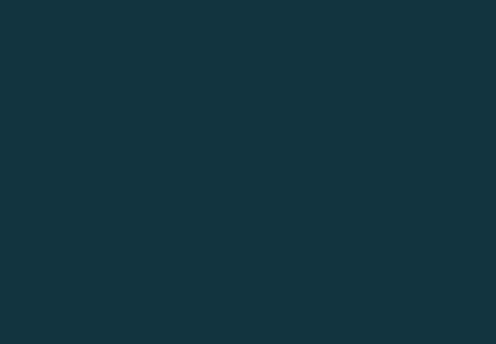
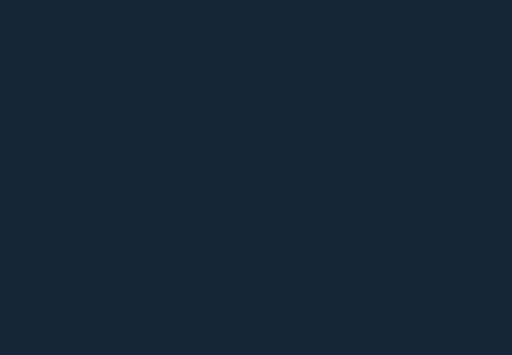
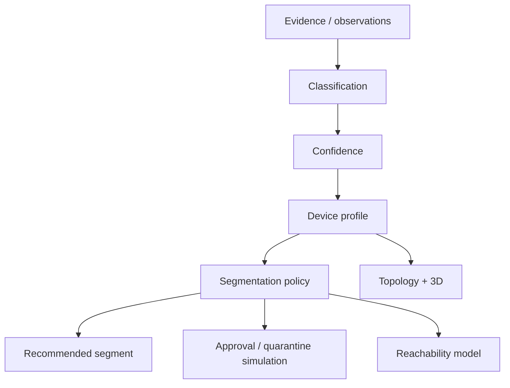

# Secure Network Segmentation Lab

**Vendor-neutral, offline-first laboratory for classification → policy → segment recommendation, quarantine/approval simulation, reachability analysis, and an interactive 3D security visualization — entirely synthetic.**

[](https://github.com/salvomazzaglia/secure-network-segmentation-lab/actions/workflows/ci.yml)
[](VERSION)
[](LICENSE)
[](backend/pyproject.toml)
[](frontend)

> Every device, address, MAC, VLAN, SSID, topology relationship, signal value,
> service observation, policy decision, and event published in this repository
> is synthetic. No real network or homelab data is included.

> The 3D map is a logical and security-oriented visualization. Wireless
> placement is illustrative and does not represent physical localization or
> distance. Wired edge lengths do not represent cable lengths.

> Version 1.0 never applies network changes. VLAN transitions, approvals,
> quarantine actions, and reachability policies are simulated or proposed
> only.





---

## 1. Project title

**secure-network-segmentation-lab** — a portfolio-ready Secure Network Segmentation Laboratory by Salvatore Mazzaglia.

## 2. Value proposition

Learn and demonstrate modern segmentation engineering practices without touching a live network: explainable device classification, declarative policy, quarantine and approval workflows, logical reachability, topology provenance, and a teaching-oriented 3D security map.

## 3. CI badge

Continuous integration runs on GitHub-hosted runners only (see badge above). Workflow: [`.github/workflows/ci.yml`](.github/workflows/ci.yml).

## 4. Version

Current release: **1.0.0** ([`VERSION`](VERSION), [`CHANGELOG.md`](CHANGELOG.md), [`docs/release-notes-v1.0.0.md`](docs/release-notes-v1.0.0.md)).

## 5. MIT

Licensed under the [MIT License](LICENSE).

## 6. Python

Backend requires **Python 3.11+** (CI matrix: 3.11 and 3.12 on Ubuntu and Windows). Package name: `secure-network-segmentation-lab` (CLI: `snsl`).

## 7. TypeScript

Frontend is **React + TypeScript (strict) + Vite + Three.js** with Vitest, ESLint, and Prettier. Local assets only — no remote UI CDN.

## 8. Screenshot

See images above and [`docs/images/sample-device-detail.png`](docs/images/sample-device-detail.png). Screenshots are refused unless the page contains **SYNTHETIC DEMONSTRATION DATA**.

## 9. Problem

Network segmentation programs fail when teams jump from raw evidence to VLAN assignment, over-trust fingerprint confidence, or lack approval gates for privileged segments. Operators also need safe ways to practice NAC-style workflows without risking production.

## 10. Privacy-first synthetic design

Documentation IPv4/IPv6 ranges only, locally administered MACs (`02:`), fictional vendors, synthetic VLAN IDs, and repository privacy guards. See [`docs/privacy-and-anonymization.md`](docs/privacy-and-anonymization.md).

> Do not publish sanitized data until it has been manually reviewed. Automated masking reduces disclosure risk but is not a guarantee of anonymization.

## 11. Architecture

Evidence feeds classification and confidence; normalized profiles feed policy; policy recommendations feed simulated segmentation and reachability views. Adapters emit DRY-RUN plans only. Details: [`docs/architecture.md`](docs/architecture.md).



## 12. Inventory

Normalized device store with segments, security state, attachment metadata, provenance, and staleness. Schema: [`schemas/device.schema.json`](schemas/device.schema.json). Docs: [`docs/inventory-model.md`](docs/inventory-model.md).

## 13. Classification

Deterministic, explainable scoring across fictional vendor hints, DHCP fingerprints, hostname patterns, services, OS family, and more. **No ML model.** Docs: [`docs/device-classification.md`](docs/device-classification.md).

## 14. Confidence

`confidence` is a **normalized heuristic evidence score**, not statistical probability. Default bands: >=0.80 classified, 0.60-0.79 uncertain, <0.60 unknown. Docs: [`docs/confidence-model.md`](docs/confidence-model.md).

## 15. Policy engine

Declarative YAML (`config/segmentation-policy.yml`) with decisions: keep, recommend_move, quarantine, require_approval, deny_transition, no_match. No executable expressions. Docs: [`docs/policy-engine.md`](docs/policy-engine.md).

## 16. Segments

Management (210), Infrastructure (220), Trusted (230), IoT (240), Guest (250), Quarantine (260) — all **SYNTHETIC VLAN ID — EXAMPLE ONLY**. Docs: [`docs/segmentation-model.md`](docs/segmentation-model.md).

## 17. Quarantine

Unknown/low-confidence devices lean Quarantine. Conceptual allow DHCP/DNS/NTP/limited egress; deny privileged and east-west paths. Logical model only. Docs: [`docs/quarantine-workflow.md`](docs/quarantine-workflow.md).

## 18. Approval workflow

Synthetic actions: approve, reject, keep_quarantined, choose_alternate_segment. UI label: **SIMULATED APPROVAL — NO NETWORK CHANGE APPLIED**. Docs: [`docs/approval-workflow.md`](docs/approval-workflow.md).

## 19. RADIUS / dynamic VLAN model

Conceptual tunnel attributes and authorization flow without secrets, packets, CoA, or Disconnect-Request. Adapter output: DRY-RUN PLAN. Docs: [`docs/radius-and-dynamic-vlan.md`](docs/radius-and-dynamic-vlan.md).

## 20. Reachability

Logical matrix from `config/reachability-policy.yml` (`allowed` / `denied` / `conditional` / `unknown`). Models intended policy — not live firewall verification. Docs: [`docs/reachability-analysis.md`](docs/reachability-analysis.md).

## 21. Wired topology

Synthetic switch/port attachment and multi-switch paths. Edge length is not cable length. Docs: [`docs/wired-topology.md`](docs/wired-topology.md).

## 22. Wireless model

Associations with RSSI buckets (strong/good/moderate/weak). No meters, triangulation, or floor plans. Docs: [`docs/wireless-visualization.md`](docs/wireless-visualization.md).

## 23. 3D map

Illustrative Three.js security map with zone clustering and view modes. Docs: [`docs/3d-visualization.md`](docs/3d-visualization.md).

> Spatial placement is illustrative. It represents logical relationships, security segmentation, and relative wireless quality — not measured physical location.

## 24. Synthetic live simulation

Deterministic seeded simulator scenarios: normal, new-device, quarantine, roaming, policy-drift, mixed. Never inspects real interfaces or sends traffic.

## 25. REST API

Loopback API under `/api/v1/*` for health, lab, devices, segments, topology, classifications, policy, reachability, drift, events, audit, adapters, simulation, and approvals. Docs: [`docs/api.md`](docs/api.md).

## 26. WebSocket

Local event stream for simulator and audit updates — no external message broker.

## 27. Quick start

```bash
git clone https://github.com/salvomazzaglia/secure-network-segmentation-lab.git
cd secure-network-segmentation-lab

python -m venv .venv
# Windows PowerShell: .\.venv\Scripts\Activate.ps1
source .venv/bin/activate
python -m pip install -e "backend/[dev]"

# Generate / validate synthetic lab (when CLI modules are available)
python -m secure_network_segmentation_lab version
python -m secure_network_segmentation_lab validate
python -m secure_network_segmentation_lab serve   # binds 127.0.0.1

cd frontend && npm ci && npm run build && cd ..
```

Privacy check anytime:

```bash
python scripts/validate-repository.py
```

## 28. CLI

Planned/available commands include: `generate-demo`, `validate`, `inventory`, `classify`, `evaluate-policy`, `reachability`, `drift`, `simulate`, `adapter-plan`, `serve`, `export`, `version`.

Example:

```bash
python -m secure_network_segmentation_lab simulate --scenario mixed --seed 42
python -m secure_network_segmentation_lab adapter-plan --adapter radius
```

## 29. Dashboard

Summary cards (totals, online, unknown, quarantined, awaiting approval, violations, wired/wireless), charts, inventory tables, device detail, and 3D views. Accessibility fallbacks always available.

## 30. Import model

Sanitized bundles only (`schemas/import.schema.json`). Sample: [`examples/sanitized-import/`](examples/sanitized-import/). Docs: [`docs/imported-data.md`](docs/imported-data.md).

## 31. Privacy

See [`docs/privacy-and-anonymization.md`](docs/privacy-and-anonymization.md) and [`SECURITY.md`](SECURITY.md). Repository guards scan for RFC1918, dangerous CI patterns, and unsafe code constructs.

## 32. Testing

Backend pytest + ruff + mypy; frontend Vitest + ESLint + Prettier + TypeScript. Docs: [`docs/testing.md`](docs/testing.md).

```bash
python scripts/run-full-ci.py
```

## 33. CI

GitHub-hosted only. Matrix: Ubuntu/Windows x Python 3.11/3.12; Ubuntu Node LTS for frontend. Actions pinned to full 40-character SHAs. No `pull_request_target`, no secrets, no network discovery, no self-hosted runners. Dependabot covers pip, npm, and github-actions.

## 34. Threat model

Covers topology, inventory, policy, evidence, imports, approvals, audit, identifiers, reports, and UI data — including leakage, injection, bypass, poisoning, supply-chain, and false-confidence risks. Docs: [`docs/threat-model.md`](docs/threat-model.md).

## 35. Limitations

- No enforcement or live adapters in 1.0
- Heuristic confidence is not probability
- Reachability is not measured firewall state
- 3D placement is not physical location
- Three documentation IPv4 /24s cannot uniquely subnet every demo VLAN — logical prefixes are used

## 36. Future real adapters

Read-only SNMP/LLDP/FDB/DHCP/RADIUS accounting/WLAN/firewall importers are roadmap items. Mutation adapters require explicit safety design first. Docs: [`docs/adapter-model.md`](docs/adapter-model.md), [`docs/roadmap.md`](docs/roadmap.md).

## 37. Roadmap

See [`docs/roadmap.md`](docs/roadmap.md) for collector, positioning, historical topology, and alerting ideas.

## 38. Skills demonstrated

Network security architecture, NAC/802.1X conceptual modeling, Python backend engineering, React/TypeScript visualization, policy-as-code, privacy engineering, DevSecOps CI hardening, and technical documentation.

## 39. Contributing

Please read [`CONTRIBUTING.md`](CONTRIBUTING.md). Pull requests that include real network data or enforcement hooks will be rejected.

## 40. License

[MIT](LICENSE) (c) Salvatore Mazzaglia.

## 41. Author

**Salvatore Mazzaglia** — GitHub: [salvomazzaglia](https://github.com/salvomazzaglia)

Repository: https://github.com/salvomazzaglia/secure-network-segmentation-lab

---

## Documentation index

| Doc | Topic |
|-----|-------|
| [architecture.md](docs/architecture.md) | System layers |
| [synthetic-data-model.md](docs/synthetic-data-model.md) | Synthetic conventions |
| [privacy-and-anonymization.md](docs/privacy-and-anonymization.md) | Privacy controls |
| [inventory-model.md](docs/inventory-model.md) | Device store |
| [device-classification.md](docs/device-classification.md) | Classifier |
| [confidence-model.md](docs/confidence-model.md) | Heuristic scores |
| [policy-engine.md](docs/policy-engine.md) | Segmentation policy |
| [segmentation-model.md](docs/segmentation-model.md) | Segments / VLANs |
| [quarantine-workflow.md](docs/quarantine-workflow.md) | Quarantine |
| [approval-workflow.md](docs/approval-workflow.md) | Approvals |
| [radius-and-dynamic-vlan.md](docs/radius-and-dynamic-vlan.md) | RADIUS model |
| [topology-model.md](docs/topology-model.md) | Nodes / edges |
| [wireless-visualization.md](docs/wireless-visualization.md) | Wireless UI |
| [wired-topology.md](docs/wired-topology.md) | Wired paths |
| [reachability-analysis.md](docs/reachability-analysis.md) | Reachability |
| [service-observation.md](docs/service-observation.md) | Services |
| [adapter-model.md](docs/adapter-model.md) | DRY-RUN adapters |
| [imported-data.md](docs/imported-data.md) | Imports |
| [3d-visualization.md](docs/3d-visualization.md) | 3D map |
| [security-boundaries.md](docs/security-boundaries.md) | Boundaries |
| [threat-model.md](docs/threat-model.md) | Threats |
| [testing.md](docs/testing.md) | Tests |
| [api.md](docs/api.md) | API |
| [roadmap.md](docs/roadmap.md) | Future work |
| [final-release-checklist.md](docs/final-release-checklist.md) | Release gate |
| [release-notes-v1.0.0.md](docs/release-notes-v1.0.0.md) | Notes |
| [security-audit-v1.0.0.md](docs/security-audit-v1.0.0.md) | Audit template |
