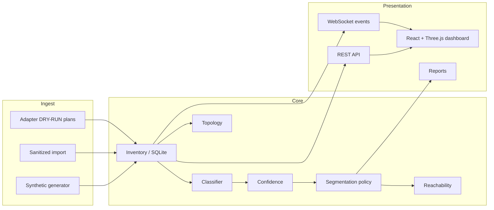

# Architecture

Version **1.0.0** — Secure Network Segmentation Lab

## Purpose

Vendor-neutral, offline-first laboratory that demonstrates:

**Evidence → Classification → Confidence → Device profile → Policy → Recommended segment**

Never: Evidence → VLAN directly. Version 1.0 never applies network changes.

## Logical layers

## Components

| Component | Role |
|-----------|------|
| Backend (`secure_network_segmentation_lab`) | Models, store, engines, API, CLI, simulator |
| Frontend | Inventory tables + illustrative 3D security map |
| Config | Declarative segments, policies, evidence weights |
| Schemas | JSON Schema draft-07 contracts |
| Scripts | CI helpers, privacy guards, screenshots |

## Source modes

1. **synthetic** — deterministic seeded lab (default)
2. **imported** — operator-sanitized bundles only
3. **live-adapter-plan** — emits DRY-RUN plans; does not connect

## Runtime boundary

- Bind host default: `127.0.0.1`
- No host discovery, ARP inspection, SNMP SET, RADIUS CoA, or switch mutation
- Simulation changes in-memory / local SQLite state only

## Critical separation

Classification answers *what is this device?*  
Policy answers *where should it live?*  
Reachability answers *what should it be able to talk to?*  

These engines share profiles but do not collapse into a single VLAN assignment shortcut.
